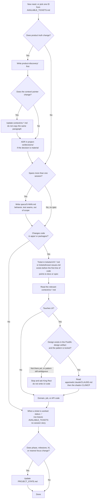
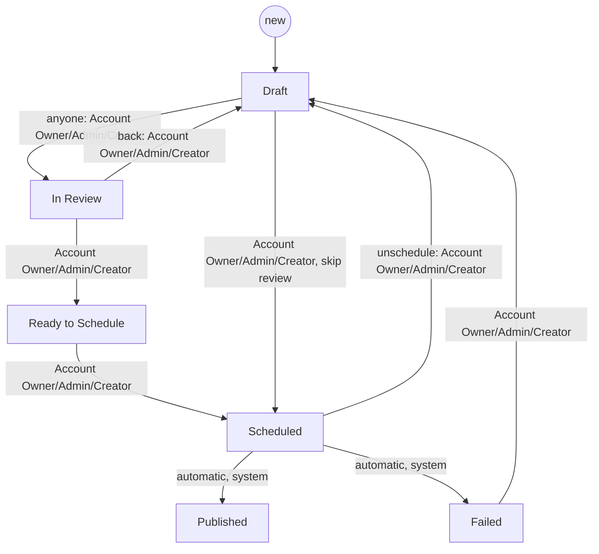

# Developer Workflow

Notes for developers (human and AI agent alike) working in this repo —
answering "how does work in this project run?" in the form of diagrams.

**This is not a Source of Truth.** The diagrams here are a **visualization**
of processes and flows already defined in other documents. If there is a
difference between the diagrams here and the original documents, **the
original documents win** — update the original document first, then sync
these diagrams.

The full entry point is still `../AGENTS.md`. This document complements it,
it does not replace it.

---

## 1. Project workflow — from need to code

How a need moves from conversation until it becomes a document or code.
Its four layers: docs, spec, ticket, then implementation (ADR-131).
Code in `apps/` and `packages/` starts only after its ticket exists (ADR-132).

Document changes do not use the ticket rule. An open Known Issue points to
one ticket; its row in `PROJECT_STATE.md` only needs to name the ID and that
ticket. The session trail is in git.

**References:** `../AGENTS.md` (rules 7, 10, 13, 14), `specs/README.md`,
`context/README.md`, ADR-131, ADR-132. ADR-062 still applies to the shape of
the per-release backlog in the parts that neither of those two ADRs changed.
UI design gate: ADR-140 (supersedes ADR-042 and ADR-056); `../AGENTS.md`
rule 10.

---

## 2. User flow — from opening the app to scheduled content

End-to-end: auth → workspace → connect account → publish. This is a
combination of `auth-architecture.md` (session & workspace resolution), UF-05
(Connect Account), and UF-01 (Create & Schedule Content) in
`product-discovery/04-ux/user-flows.md` — not a new flow.

```mermaid
flowchart TD
  A[User opens the app] --> B{Active session?<br/>cookie better-auth.session_token}

  B -->|No| C[Sign up / Sign in<br/>email-password or Google OAuth]
  C --> C2[Session cookie created<br/>HTTP-only, 7 days]
  B -->|Yes| D{Middleware: workspaceSlug<br/>valid in the URL?}
  C2 --> D

  D -->|No workspace yet| E[Onboarding: create the first workspace<br/>user automatically becomes Owner]
  D -->|Has one, role resolved| F[Enter the active workspace<br/>x-workspace-id + x-workspace-role]
  E --> F

  F --> G{Social account<br/>connected? UF-05}
  G -->|Not yet| H[Workspace Settings →<br/>Connected Accounts]
  G -->|Yes| M[Publish → Drafts → New Post]

  H --> I[+ Connect Account → choose platform<br/>IG · FB · X · LinkedIn · TikTok<br/>YouTube · Threads · Pinterest]
  I --> J[OAuth on the third-party platform]
  J --> K{OAuth succeeded?}

  K -->|Yes| K2[Account appears, status Active]
  K -->|No / cancelled| H

  K2 --> M
  M --> N[Write caption<br/>manual; drafts from the client AI via MCP land in Drafts]
  N --> O[Attach media<br/>local file or Media Library]
  O --> P[Account Selector<br/>choose one or more target accounts]
  P --> P2[Content Format per account — ADR-039<br/>IG/FB: Post · Reel · Story<br/>Pinterest: Pin · others: Post]
  P2 --> Q{Ready to schedule?}

  Q -->|Not yet| R[Save as Draft]
  Q -->|Yes| S[Schedule Picker → Confirmation Summary<br/>→ Schedule]

  R --> T[Status: Draft<br/>shown in Publish → Drafts]
  S --> U[Status: Scheduled<br/>shown in Calendar & Queue]
```

**References:** `../product-discovery/05-architecture/auth-architecture.md`,
`../product-discovery/04-ux/user-flows.md` (UF-01, UF-05),
`../product-discovery/04-ux/key-screen-patterns.md` (KSP-05), ADR-039.

Engagement (UF-04) and Analytics (UF-06) are not drawn here — both are
separate cycles after content is published, see `user-flows.md` directly.

---

## 3. Content status cycle (state per role)

Six canonical statuses and who may trigger each transition — from
`product-discovery/02-product/roles-permissions.md`. Since ADR-074 (3 roles:
Account Owner/Admin/Creator), all roles have the same rights for content
status transitions — no role is limited to only reaching `In Review` anymore.

**Note:** A post that is already `Scheduled` is **not** automatically
cancelled when the account disconnects (KSP-D09) — it keeps waiting in the
queue until the account reconnects.

**References:** `../product-discovery/02-product/roles-permissions.md`,
`../product-discovery/04-ux/key-screen-patterns.md` (KSP-D09).

---

## Related Documents

- `../AGENTS.md` — agent entry point, hard rules
- `../context/README.md` — index of AI Context per domain
- `PROJECT_STATE.md` — phase, milestone, Known Issues, blockers
- `AVAILABLE_TICKETS.md` — queue of unfinished tickets; release tickets in `tickets/vXX-*.md`, Known Issue tickets in `tickets/known-issues.md` (ADR-134)
- `specs/README.md` — spec shape for work that spans more than one session (ADR-131)
- `DECISIONS.md` — ADR index; full text in `decisions/`
- `../product-discovery/04-ux/user-flows.md` — full flows (UF-01 through UF-06)
- `../product-discovery/02-product/roles-permissions.md` — roles & content status
- `../product-discovery/05-architecture/auth-architecture.md` — auth & session detail
- `../context/ctx-design.md` — pointer to the Postific design artifact (ADR-140; the `design/` folder was deleted, ADR-045)
